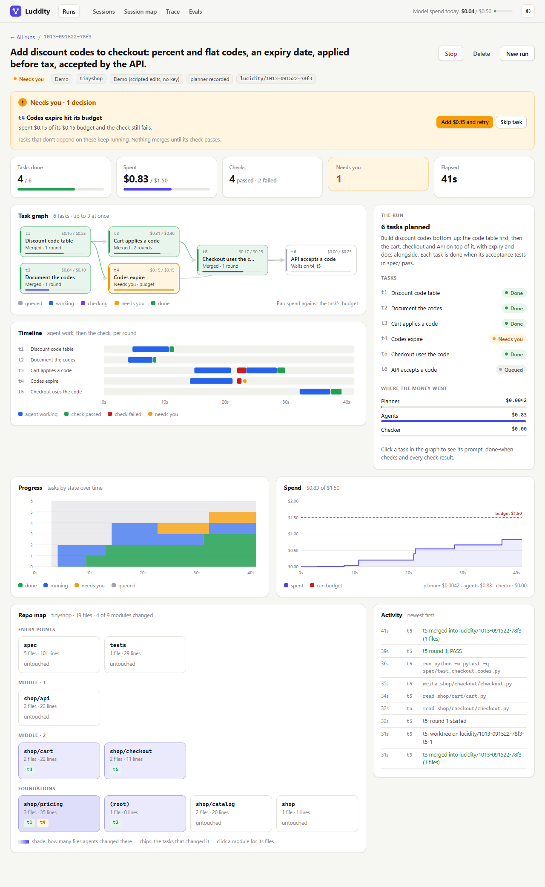
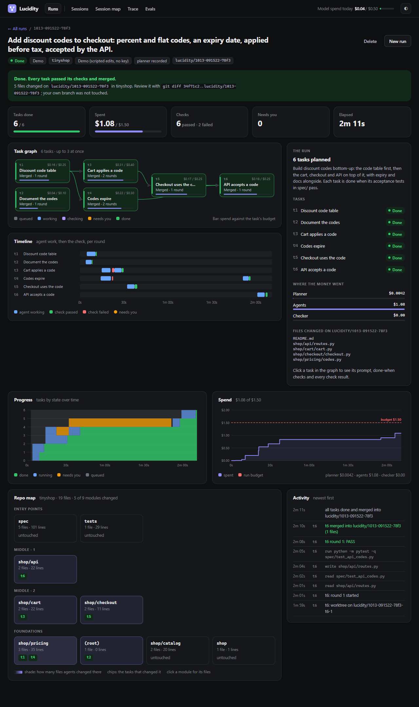

# Lucidity

An orchestrator for coding agents that you can watch. Give it a goal and a git repo. It plans the
goal into tasks, each with a done-when contract and a budget, runs a coding agent on every task in
its own git worktree, and has a separate checker decide whether each task is really done. Nothing
merges without a pass. While it runs you see the task graph, progress and spend over time against
the budget, and a map of the repo showing which agents changed which modules. When a check keeps
failing or a budget hits its cap, the run stops that task and asks you.

"Done" can be a test passing, or a score clearing a bar. Point Lucidity at an eval script and a task
can be "done when held-out accuracy ≥ 0.85 and no class's F1 drops more than 0.05". That makes it CI
for NLP and LLM pipelines (prompts, parsers, classifiers, extractors): an agent can say it's finished
and still get sent back because a number moved the wrong way.



The main demo needs no API key. A bundled complaint router sends real consumer complaints from the
CFPB Consumer Complaint Database to one of six product teams (credit reporting, debt collection,
credit card, checking and savings, money transfer, mortgage) by asking `gpt-6-luna`. It starts at
0.80 held-out accuracy. The goal is 0.85 without any product's F1 dropping more than 0.05, tuning on
a dev split only. The demo replays a live `gpt-6-luna` run: its plan, the agents' edits and the
model's answers to every prompt they tried are recorded, and everything after the edits is real. The
eval runs on every round, the checks pass or fail on its numbers, the budgets bind, and the merges
are real git merges. In one round the agent rewrites the prompt and reports "held-out 0.85, the bar
passes". The eval measures 0.847 and `checking_savings.f1` down 0.07, so the check sends it back.

## Quickstart (one command)

You need Python 3.10 or newer and git.

```
git clone https://github.com/grant-wei/lucidity-agents
cd lucidity-agents
python start.py          # Windows: py start.py
```

`start.py` makes a `.venv`, installs `requirements.txt` into it (first run only, about a minute) and
opens http://127.0.0.1:8765. Click **Run the demo** (Complaint routing is picked). In about a
minute you'll see:

1. the goal planned into 4 tasks: diagnose dev misses, fix the answer parser, rewrite the prompt,
   verify, each done when its tests pass or its held-out scores clear the bar,
2. the scores chart dip when the parser task merges (0.80 to 0.78, within the 0.05 per-product
   allowance) and climb to 0.854 when the prompt task does,
3. the prompt task claim the bar on round 1 and fail its check on the measured numbers, then pass on
   round 2 (click it in the task graph to see "Agent said" next to "Check found"),
4. **What merged**: every product's final F1 next to where it started, and each task's diff.

Two more demos run the same loop: **Invoice extraction** (F1 per field on synthetic invoices, with a
task that hits its budget and asks you for more) and **Discount codes** (a toy shop where done means
tests pass).

If port 8765 is taken it says so; pick another with `LUCIDITY_PORT=8800 python start.py`
(PowerShell: `$env:LUCIDITY_PORT="8800"; py start.py`). Set `LUCIDITY_NO_BROWSER=1` to skip opening
a browser, and `LUCIDITY_DEMO_SPEED=4` to play the demo four times faster.

Prefer to set it up by hand? `python -m venv .venv`, install `requirements.txt` with the venv's pip,
then run `app.py` with the venv's Python.

## Point it at your own repo

1. Add a key. Copy `.env.example` to `.env` and set `OPENAI_API_KEY`. Lucidity looks for `.env` in
   this folder first, then the folder above it. `OPENAI_MODEL` is optional and defaults to `gpt-6-luna`.
   A `.env` that still holds the placeholder key is ignored.
2. Restart, pick who does the work, type a goal, and give the full path to a git repo with at least
   one commit:
   - **Built-in**: a small agent on your OpenAI key that can read, write and run allowlisted tests.
   - **Claude Code**: your `claude` CLI, headless, with a hard `--max-budget-usd` per round.
   - **Codex**: your `codex` CLI, sandboxed to the task's worktree.
3. Optionally give an **eval command** (below) so tasks can be judged on scores, not just tests.
4. Untick "Start as soon as the plan is ready" if you want to read the plan before any agent runs.

Your checkout is never touched. A run gets its own branch `lucidity/<run-id>` in a worktree under
`state/`, each task branches off that, and only work the checker passed is merged back into it. When
the run is done, **What merged** shows each task's diff; merging the branch into your own (or
deleting it) is up to you.

### Bring your own eval

An eval command is `python evals/<script>.py [args]`. The script must live in the repo's `evals/` or
`eval/` folder; it runs without a shell, with a timeout, from the task's worktree. It should print
one JSON line with its scores as its last JSON output:

```
{"metrics": {"vendor": {"f1": 0.82}, "total": {"f1": 0.91}}}
```

Nested numbers are flattened to dotted names (`vendor.f1`, `total.f1`); anything that isn't a number
is ignored. If the eval calls a model itself, it can add `"cost": {"usd": 0.0071}` to that line and
Lucidity counts it against the run budget (as "eval" spend), whether a check or a worker ran it. A non-zero exit or no JSON line counts as a failed check. With an eval command set, the
planner can use two more kinds of done-when condition:

- **metric**: a named score must reach a bar, e.g. `total.f1 >= 0.90`.
- **no_regression**: no score matching a pattern (`*.f1`) may drop more than a set amount below
  where it stood when the task started.

The eval runs on the run branch before the first task and again after every merge, which is what the
Scores chart and Metrics table plot. Keep tuning data and checking data apart (the demo's agents are
told to tune on `dev` only; the checks read `heldout`).

## How a run works

```
goal ─► plan ─► run tasks (parallel, each in a worktree) ─► check ─► merge ─► done
                       ▲                                     │
                       └──── failed: reasons go back ◄───────┘   (1 to 4 rounds, set per task)
                                                             └─► needs you
```

- **Plan.** The planner model gets the goal plus the repo's file list and README opening. It returns
  tasks with dependencies, a budget for each, and done-when conditions. Plain code then validates the
  graph before anything runs: a cycle is rejected, unknown dependencies are dropped, budgets that add
  up to more than the run's are scaled down, a test command off the allowlist becomes a judgment
  condition, and every task must have at least one condition a program can check.
- **Work.** A task starts when its dependencies have merged. The worker sees its task prompt and the
  contract, works only inside its worktree, and never commits, merges or pushes.
- **Check.** Conditions a program can check (a file exists, a test passes, a score clears its bar or
  didn't drop) are run first by plain code, and a failure there is final whatever the worker's report says. Only
  conditions that need judgment go to the checker model, in a separate call with no tools that sees
  the contract, the program's results, the diff and the report, never the worker's reasoning.
- **Needs you.** A task stops and asks you when its checks fail every round, it spends its budget, its
  merge conflicts, or the checker wants a person. Other tasks keep going. You can add budget and
  retry, retry, or skip.

## What you see

- **Runs**: the goal composer up front and every past run below it.
- **A run**: the needs-you callout, the scores chart against the bar and a metrics table (start, now,
  which task moved each score, and what the checks stopped before it merged), the task graph (click
  a task for its prompt, contract, and each round's "Agent said" next to "Check found"), a per-round
  timeline, what merged with each task's diff, progress by task state over time, spend against the budget,
  the repo map shaded by how much agents changed each module, and a live activity feed.
- **Sessions, Session map, Trace, Evals**: Lucidity's monitor for agent sessions you started by hand
  in Claude Code or Codex. It shows synthetic sample sessions by default; `LUCIDITY_DATA=local` reads
  your own `~/.claude/projects` and `~/.codex/sessions`. With no key it shows a recorded triage of the
  samples.



## What gets sent to which model

| Step | Goes to | What it sees |
|---|---|---|
| Planner | `OPENAI_MODEL` (default `gpt-6-luna`) | your goal, the repo's file list (up to 300 paths) and the first 4,000 characters of its README |
| Built-in worker | same | its task prompt and contract, plus the files it chooses to read in its worktree |
| Claude Code / Codex worker | your own CLI and account | its task prompt and contract; the CLI reads files in the worktree as it works |
| Checker | `OPENAI_MODEL` | the contract, the program's check results, the diff and the worker's report, redacted |
| Session monitor | `OPENAI_MODEL` | the last 14 events of each changed session, with keys, tokens and passwords redacted |
| Eval command | nothing | it's your script, run locally; only its printed scores reach the checker |
| Demo | nothing | the plan, edits and model answers are recorded; no model is called |

Text from workers and sessions is wrapped as data and the models are told never to follow it.

## Cost caps

- **Per run:** you set a budget when you start (default $1.00 for live runs). A run stops starting
  tasks when it's spent, and no run can be budgeted above `LUCIDITY_MAX_RUN_USD` (default $5.00),
  including budget you add later.
- **Per task:** each task gets a share of the run budget from the plan. Claude Code enforces it with
  `--max-budget-usd`; for the others Lucidity stops at the end of the round that crosses it.
- **Eval spend:** an eval that reports its own model cost (above) is charged to the run and its task.
- **Lucidity's own calls** (planner, checker, built-in worker, monitor): $0.50 a day and 120 requests
  an hour by default (`LUCIDITY_DAILY_USD_CAP`, `LUCIDITY_CALLS_PER_HOUR_CAP`). When that trips, no
  further call is made and the page says so. Raise it for real live runs.
- Every model call is logged with its token counts and cost to `logs/usage.jsonl`.

## Safety

- Tests run only through allowlisted runners (`pytest`, `python -m pytest`, `npm test`, `go test`,
  `cargo test`), and evals only as a Python script under `evals/`, both without a shell, with a
  timeout.
- Workers can't touch your branch or push; merges happen only after a pass, into the run's branch.
- If a model reply never fits the expected shape, that call is marked failed (its cost still counts)
  and the task goes to you instead of passing.
- In the monitor, Pause / Stop / Let it run are recorded to `logs/actions.jsonl`; Lucidity never
  stops your hand-started agents itself.

## Tests and evals

```
.venv/Scripts/python -m pytest -q    # 137 tests, offline, no key needed (macOS/Linux: .venv/bin/python)
python evals/run_evals.py            # monitor evals: 30 labeled cases x 5 configurations x 3 runs, about $0.07
python smoke.py                      # one tiny model call, to check your key
```

The tests run all three demo loops in temp git repos (plan, parallel work, a regression the agent called
done that the check catches, a budget stop, add budget, merge, final scores) and the run API over
HTTP, plus the eval-command rules and metric conditions on their own.

## Layout

```
start.py              one-command launcher
app.py                local web server (standard library)
lucidity/orch/        the orchestrator: runs, worktrees, contracts, gate (checks), workers, demo, repo map
lucidity/agents/      planner, worker, checker and the session monitor's agents
lucidity/             config, model calls, cost, budget breaker, redaction, tracing
static/               the UI: index.html, style.css, app.js (runs), monitor.js (sessions)
sample_data/demos/    the three demos: each has a repo/, a recorded scenario.json and steps/ of edits
sample_data/          synthetic sessions, labels and the recorded triage for the monitor
evals/  tests/        monitor evals and the test suite
```

What's not done yet is in [TODO.md](TODO.md).
